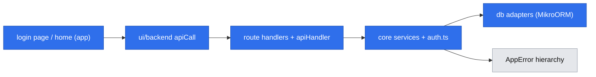
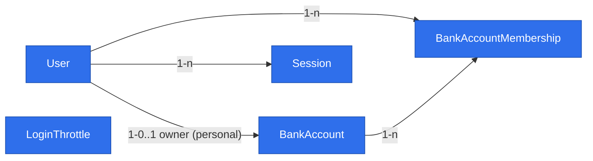

# Logowanie i fundament aplikacji (auth + warstwy wielokrotnego użytku)

Status: DRAFT po decyzjach właściciela i review, bez otwartych pytań.
Źródła: issue #10 (E01-S01), zadania #17-#20, epik #6, #11 (E01-S02); `.ai/specs/product-brief.md` (P01, D01, D02, A02, R01, R03); `AGENTS.md`; `.ai/specs/2026-09-01-engineering-standards.md`; `BACKWARD_COMPATIBILITY.md`.

## 📝 TLDR

Właściciel loguje się własnym kontem użytkownika i po zalogowaniu widzi konto bankowe wspólne i swoje osobiste (E01-S01, przyszłe zachowanie). "Konto użytkownika" (login) to `User`; "konto bankowe" (wspólne lub osobiste, z którego pochodzą wpisy) to `BankAccount`. Ta sama praca kładzie fundament pod kolejne epiki (Awilix, `apiHandler`, env, logger, auth, `ui/backend`) i model, w którym żona (E01-S02) jest członkiem wyłącznie konta wspólnego, bez UI żony.

## 📝 Problem Statement

Dane finansowe muszą być za logowaniem, a arkusz Google nie rozróżnia osób (P01). D01: osobne logowanie właściciela i żony oraz konta wspólne i osobiste; R03: "ile zostanie" per konto, więc `BankAccount` jest pojęciem pierwszej klasy. D02/A02: żona wspierana, ale E01-S01 od niej nie zależy.

Stan dziś: `core/http` ma tylko `errors.ts` (kody snake_case: `validation_error`, `unauthorized`, `forbidden`, `not_found`, `conflict`); `db` ma `createOrmConfig`, `baseEntityProperties`, pusty rejestr encji, migrację `initial`; `app` ma `GET /api/health`, layout, stronę główną i pusty `next.config.ts` (tylko `transpilePackages`); `ui`/`core` eksportują `packageName`; `.env.example` ma tylko `DATABASE_URL`; brak awilix/zod/pino/hashowania; `tsx` jest tylko w `db`.

## 📝 Decisions

Wybory właściciela produktu, 2026-11-17; Q23-Q28 z 2026-11-24 wynikają z zatwierdzonej mapy ekranów E01 (PR #55, `.ai/specs/design/2026-11-24-mapa-ekranow-e01.md`, luki P1-P17).

| Id | Decyzja | Właściciel | Data |
|---|---|---|---|
| Q1 | Konta użytkowników powstają skryptem CLI (seed); brak publicznej rejestracji | właściciel produktu | 2026-11-17 |
| Q2 | Sesje po stronie serwera w PostgreSQL (zmiana standardów: Step 2.0) | właściciel produktu | 2026-11-17 |
| Q3 | Własna cienka warstwa auth. Auth.js rozważony i odrzucony: Credentials wymaga JWT wbrew Q2, adapter MikroORM tylko 5/6 (projekt ma 7), tryb maintenance | właściciel produktu | 2026-11-17 |
| Q4 | Hashowanie argon2id | właściciel produktu | 2026-11-17 |
| Q5 | `BankAccount` (shared/personal) + `BankAccountMembership` (nazwa zmieniona z `Account`, by nie mylić z kontem logowania) | właściciel produktu | 2026-11-17 |
| Q6 | Seed dla właściciela tworzy jedno konto wspólne i jego osobiste; dla żony tryb `--shared-only` (członek tylko konta wspólnego, bez osobistego) | właściciel produktu | 2026-11-17 |
| Q7 | Bez ról; dostęp wyłącznie z członkostwa | właściciel produktu | 2026-11-17 |
| Q8 | Login = e-mail małymi literami | właściciel produktu | 2026-11-17 |
| Q9 | Tylko rate limiting logowania; bez resetu/zmiany hasła | właściciel produktu | 2026-11-17 |
| Q10 | Jeden spec, dwie fazy: 1 fundament bez konsumenta-auth, 2 wszystko pozostałe | właściciel produktu | 2026-11-17 |
| Q11 | `ui/backend` tylko `apiCall` + feedback (faza 2); `CrudForm`/`DataTable` z #22 | właściciel produktu | 2026-11-17 |
| Q12 | Env: `DATABASE_URL`, `SESSION_SECRET` (>= 32 B), dane zasiewu tylko dla skryptu; nigdy w repo/migracjach | właściciel produktu | 2026-11-17 |
| Q13 | Model gotowy na żonę + test 403 na koncie osobistym właściciela; bez UI żony | właściciel produktu | 2026-11-17 |
| Q14 | 403 dla członka bez dostępu; blokada po 5 nieudanych próbach / 15 min; sesja przesuwna 30 dni nieaktywności plus twardy limit 90 dni od logowania; nagłówek CSRF `X-Requested-With` | właściciel produktu | 2026-11-17 |
| Q15 | Środowisko: teraz tylko lokalnie, później serwer. `TRUSTED_PROXY_HOPS` opcjonalne (domyślnie 0), limit per IP nie jest dopracowywany; hosting/HTTPS/proxy to osobna historia "gotowość produkcyjna" przed wdrożeniem (spec ją tylko wskazuje) | właściciel produktu | 2026-11-17 |
| Q16 | Cookie `secure` steruje opcjonalne `SESSION_COOKIE_SECURE` (domyślnie true przy `NODE_ENV=production`); lokalne buildy produkcyjne, `test:integration:app` i testy integracyjne ustawiają false | właściciel produktu | 2026-11-17 |
| Q17 | Lokalnie hasła proste, deweloperskie; zakładanie kont, reset i zmiana hasła przed produkcją w historii "gotowość produkcyjna" (Q9 bez zmian) | właściciel produktu | 2026-11-17 |
| Q18 | Hasło deweloperskie nie trafia do repo (`SEED_PASSWORD=` puste w `.env.example`; wartość w lokalnym `.env` lub stdin). Seed odrzuca hasło < 8 znaków, a przy `NODE_ENV=production` wymaga >= 12 | właściciel produktu | 2026-11-17 |
| Q19 | Brak globalnego singletona konta wspólnego; model dopuszcza wiele kont wspólnych; idempotencja seeda przez unikalność `(type, name)` dla kont wspólnych, nazwa z konfiguracji seeda (domyślnie "Wspólne") | właściciel produktu | 2026-11-17 |
| Q20 | Minimalna `GET /api/bank-accounts/{id}` w 2.4b jako konsument `assertMemberOfBankAccount` i test izolacji z #10 przez HTTP; wzorzec dla E02/E03 | właściciel produktu | 2026-11-17 |
| Q21 | Hasła w testach losowe (`randomBytes`), nigdy literały; unity z fake'iem `PasswordHasher`; adapter argon2id z parametrami z konstruktora; jeden test integracyjny z parametrami produkcyjnymi | właściciel produktu | 2026-11-17 |
| Q22 | Dostarczanie: jeden PR na Krok (2.0 może iść z 2.1), każdy zielony i wdrażalny osobno, numer issue w opisie PR | właściciel produktu | 2026-11-17 |
| Q23 | Stany logowania i listy kont dostają kryteria (P1-P3): pusta lista kont (obronny stan, bo seed zawsze tworzy członkostwo, P15), blokada 429 z komunikatem i czasem, błędy walidacji/sieci/500 bez utraty wpisanych danych i bez ujawniania szczegółów; e-mail normalizowany do małych liter po stronie serwera, bez komunikatu | właściciel produktu | 2026-11-24 |
| Q24 | Zalogowany użytkownik na `/login` jest przekierowany na `/` (P5); wylogowanie to przycisk wykonujący `POST /api/auth/logout` z nagłówkiem CSRF, wyglądający jak link, po sukcesie przekierowanie na `/login` (P6) | właściciel produktu | 2026-11-24 |
| Q25 | Pasek aplikacji pokazuje `displayName` zalogowanego (P7) | właściciel produktu | 2026-11-24 |
| Q26 | Lista kont: link konta prowadzi na `/?account=<id>`, bez parametru `account` `/` pokazuje listę (P8); kolejność: wspólne przed osobistymi, potem alfabetycznie po nazwie (P9); UI listy nie zakłada jednego konta wspólnego (P10) | właściciel produktu | 2026-11-24 |
| Q27 | "Bez UI żony" (Q13) oznacza brak odrębnych ekranów: żona używa tych samych ekranów (P12); Step 2.7 zawiera scenariusz w przeglądarce dla żony; ryzyko A02 dla E01-S02 odnotowane, materiał z rozmowy z żoną do zebrania przed wdrożeniem (P16) | właściciel produktu | 2026-11-24 |
| Q28 | Odmowa dostępu do istniejącego cudzego konta bankowego to zawsze 403 (kryteria #10 i #11 ujednolicone, P13); E01 nie ma ekranu odmowy dostępu, ekran "brak dostępu" definiują E02/E03 (P14) | właściciel produktu | 2026-11-24 |

Powiązane: D01, D02, R01 (brak kwot w tym zakresie), R03. Spec ich nie zmienia.

## 📝 Research (skrót)

Auth.js, Better Auth i Lucia: sesja = losowy token, w DB tylko hash, cookie httpOnly, unieważnianie przez usunięcie rekordu; przejmujemy to, pomijamy OAuth, magic linki, refresh tokeny, 2FA. Firefly III / Actual Budget: współdzielenie przez członkostwo, bez ról; pomijamy wielowalutowość i zaproszenia.

## 📝 Architecture

Kierunek zależności bez zmian. Nowe elementy:

- `core/config/env.ts`: schemat Zod złożony z części (baza, sesja: `SESSION_SECRET`, `SESSION_COOKIE_SECURE` domyślnie true przy `NODE_ENV=production`, `TRUSTED_PROXY_HOPS`); `NODE_ENV` tylko czytany (domyślnie `development`), nie wymagany i nie w `.env.example`. Walidacja fail-fast w `instrumentation.ts` `register()` (runtime Node); przy buildzie nie jest wymuszana (aplikacja buduje się bez bazy i sekretów), `GET /api/health` nie zależy od env sesji. Osobny `seedEnvSchema` (`SEED_PASSWORD`, nazwa konta wspólnego) tylko dla skryptu.
- `core/logger.ts` (pino): jawne ścieżki redakcji `*.password`, `*.passwordHash`, `*.token`, `req.headers.cookie`, `req.headers.authorization`, `res.headers["set-cookie"]`; zasada: nie logujemy body żądań.
- `core/http/apiHandler.ts`: `createApiHandler(createScope)` zwraca `apiHandler(fn(req, scope))`; w `app` `createScope = () => container.createScope()`. Mapuje `AppError` na kopertę, nieoczekiwane błędy loguje i zwraca 500 `internal` bez stack trace. Awilix w `InjectionMode.PROXY`. ORM tworzony leniwie raz na proces (cache na `globalThis` tylko w trybie dev, jako uzasadniony wyjątek na HMR), `EntityManager` forkowany per scope.
- Nowe podklasy `AppError` w `errors.ts`: `InvalidCredentialsError` (401, `invalid_credentials`), `TooManyRequestsError` (429, `too_many_attempts`, pole `retryAfterSeconds`).
- `core/http/auth.ts`: `requireSession(token, resolver)`, `assertMemberOfBankAccount(session, bankAccountId, lookup)` (403, fail closed); porty `SessionResolver.resolve(token: string | null)` i `BankAccountMembershipLookup`. Port przyjmuje token, bo `cookies()` w Next 16 jest asynchroniczne i dostępne tylko w `app`. Brak `requireRole` (Q7). Reużywane przez E02, E03, E01-S02.
- `core/services/{auth,bank-accounts,users}`: `AuthService`, `BankAccountService`, `UserProvisioningService` (seed), porty `PasswordHasher`, `*-repository.port.ts`, `LoginThrottle`.
- `db`: encje, adaptery MikroORM (surowe SQL tylko w adapterze throttla), migracja.
- `app`: `container/{container,cradle}.ts` (jawna rejestracja), adapter `Argon2PasswordHasher` (`@node-rs/argon2`), route `api/auth/*`, `api/bank-accounts`, `(auth)/login`, widok na `/`, `scripts/seed-user.ts`.
- `ui/backend/{api/apiCall.ts,feedback/*}`: jedyny `fetch` do `/api/*`, zawsze nagłówek `X-Requested-With: aitl`. Koperta deklarowana osobno od `core`.
- Bundling: `next.config.ts` dostaje `serverExternalPackages` dla `@mikro-orm/*`, `pino` i `@node-rs/argon2`. **Do zweryfikowania w kroku 1.3** (nie sprawdzone): domyślna lista Next 16 oraz zachowanie MikroORM 7 pod bundlerem.
- Cookie sesji nie jest czytane ani ustawiane w `proxy.ts`; ustawia je wyłącznie route handler (`POST /api/auth/login`, `logout`) przez `await cookies()`, a strony serwerowe tylko je czytają.

## 📝 Data Model

Tabele liczba mnoga snake_case, UUID z `baseEntityProperties`.

- `users`: `email` (unikalny, `CHECK email = lower(email)`), `display_name`, `password_hash` (argon2id).
- `bank_accounts`: `type` (`shared`|`personal`), `name`, `owner_user_id` (FK `users`, `ON DELETE RESTRICT`, null dla shared). `CHECK`: personal <=> owner niepusty; częściowy unikalny indeks: jedno personal na właściciela; unikalne `(type, name)` dla kont wspólnych (częściowy indeks `WHERE type='shared'`; model dopuszcza wiele kont wspólnych, bez singletona). `owner_user_id` jest tylko znacznikiem; dostęp wynika wyłącznie z członkostwa.
- `bank_account_memberships`: `user_id`, `bank_account_id` (FK, `ON DELETE CASCADE`), unikalne `(user_id, bank_account_id)`. Niezmiennik "członek konta osobistego = wyłącznie właściciel" wymusza `BankAccountService`/`UserProvisioningService` (test jednostkowy i integracyjny).
- `sessions`: `user_id` (FK, `CASCADE`), `token_hash` (unikalny), `expires_at` (przesuwne), `absolute_expires_at` (= logowanie + 90 dni, niezmienne), `created_at`. Sesja ważna, gdy `now < expires_at` i `now < absolute_expires_at`. `expires_at = min(now + 30 dni, absolute_expires_at)`, przedłużane przy użyciu najwyżej raz na godzinę. Jedynym autorytetem jest DB; cookie (`aitl_session`, httpOnly, `secure` wg `SESSION_COOKIE_SECURE`, sameSite=lax, `maxAge` 90 dni, ustawiane raz przy logowaniu) niczego nie przedłuża.
- `login_throttles`: `key_hash` (unikalny), `failures`, `window_started_at`, `locked_until`.
- Hashe: `token_hash = HMAC-SHA256(SESSION_SECRET, "session:" + token)` (token 32 B losowych), `key_hash = HMAC-SHA256(SESSION_SECRET, "throttle:" + klucz)`; prefiksy rozdzielają domeny. Wyszukiwanie po hashu, więc `timingSafeEqual` zbędne. Rotacja sekretu wylogowuje wszystkich (zamierzone).
- Sprzątanie: przy każdym logowaniu usuwane są wygasłe sesje (oba terminy) i wiersze throttla starsze niż 24 h, jednym zapytaniem ograniczonym indeksem.

(Brak istniejących encji domenowych do powiązania.) Widok: `.ai/data-model/2026-11-17-auth-and-app-foundation.html`.

## 📝 API Contracts

Koperta wg `BACKWARD_COMPATIBILITY.md` §2; body parsowane Zodem z `core/validators/auth/`; e-mail jest normalizowany do małych liter po stronie serwera przed walidacją i wyszukaniem, bez osobnego komunikatu (Q8, Q23).

- `POST /api/auth/login` (publiczna): `{ email, password }` -> 200 `{ ok:true, data:{ user:{ id, email, displayName } } }` + cookie. Błędy: 400 `validation_error`, 401 `invalid_credentials` (ten sam komunikat dla nieznanego e-maila i złego hasła), 429 `too_many_attempts` z `error.retryAfterSeconds` (nowe pole koperty błędu, zmiana kontraktu zapisywana w `BACKWARD_COMPATIBILITY.md` w Step 2.4b) i nagłówkiem `Retry-After`.
- `POST /api/auth/logout` (publiczna, tylko CSRF): usuwa sesję po tokenie, jeśli istnieje; zawsze czyści cookie i zwraca 200.
- `GET /api/bank-accounts` (sesja): `{ ok:true, data:{ bankAccounts:[{ id, type, name }] } }` tylko z członkostwa, w kolejności: konta wspólne przed osobistymi, potem alfabetycznie po nazwie (Q26).
- `GET /api/bank-accounts/{id}` (sesja): `{ ok:true, data:{ id, type, name } }`; cudze konto -> 403 przez `assertMemberOfBankAccount` (wzorzec dla E02/E03).
- Mutujące route wymagają nagłówka CSRF, inaczej 403. Strony chronione czytają `await cookies()` (to czyni je dynamicznymi, bez dodatkowej konfiguracji) i przekierowują na `/login`.

## 📝 UI/UX

`/login` (Tailwind): e-mail, hasło, przycisk; stany: wysyłanie, błąd ogólny, błędy walidacji pól, brak sieci i błąd serwera (500), w każdym wpisane dane zostają w formularzu, a komunikat nie ujawnia szczegółów, blokada z czasem (czas statyczny, bez odliczania na żywo) (Q23). Zalogowany użytkownik na `/login` jest przekierowany na `/` (Q24). Teksty jako nazwane stałe. `/`: lista kont bankowych użytkownika (`EmptyState` gdy pusta, stan obronny: Q23), każde konto jako link `/?account=<id>`, bez parametru `account` `/` pokazuje listę (Q26); UI listy nie zakłada jednego konta wspólnego (Q26, Q19); pasek pokazuje `displayName` zalogowanego (Q25); wylogowanie jako przycisk wykonujący `POST /api/auth/logout` z nagłówkiem CSRF, wyglądający jak link, po sukcesie przekierowanie na `/login` (Q24). Żona używa tych samych ekranów (Q27). Odmowa dostępu do cudzego konta istnieje w E01 tylko w API (403); ekran "brak dostępu" poza zakresem E01 (Q28). Etykiety pól, `autocomplete`, fokus na błędzie. Prototype: brak zaakceptowanej wersji.

## 📝 Edge Cases & Failure Scenarios

- **Brute-force.** Zakres lokalny (Q15), limit per IP minimalny. `TRUSTED_PROXY_HOPS` opcjonalne (domyślnie 0). Dla N > 0 IP to wpis N-ty od prawej w `X-Forwarded-For`; dla 0 nagłówek jest ignorowany, a komponent IP w kluczu stały (Route Handler Next nie udostępnia adresu gniazda; do zweryfikowania w Step 2.4b). Dwa liczniki: `ip+email` (próg 5) i sam `email` (wyższy próg 20), okno 15 min, blokada 15 min; wiersze powstają także dla nieistniejących e-maili.
- **Algorytm.** Przed weryfikacją zwykły odczyt obu wierszy; `locked_until > now` -> 429 bez weryfikacji hasła. Po nieudanej weryfikacji atomowy `INSERT ... ON CONFLICT DO UPDATE ... RETURNING` zwiększa licznik, resetuje okno po wygaśnięciu i ustawia `locked_until` po przekroczeniu progu, poza transakcją z weryfikacją hasła. Udane logowanie usuwa oba wiersze użytkownika. Test współbieżny: równoległe nieudane próby liczą się bez gubienia inkrementów.
- **Stały koszt.** Dla nieznanego e-maila weryfikacja względem hasha-wabika z tymi samymi parametrami argon2id, liczonego raz (cache w adapterze hashera).
- Sesja wygasła, usunięta albo po 90 dniach -> 401 i redirect; wylogowanie powtórne -> 200.
- Blokada logowania (429): komunikat podaje czas z `retryAfterSeconds` i nie ujawnia, czy użytkownik istnieje (Q23).
- Baza niedostępna -> 500 `internal`, UI pokazuje ogólny komunikat bez szczegółów i bez utraty wpisanych danych; start i build bez DB działają. Brak/zbyt krótki `SESSION_SECRET` -> start odmawia z błędem walidacji bez wypisania wartości.
- **Seed.** Idempotentny po e-mailu użytkownika i `(type, name)` konta wspólnego, w transakcji; hasło < 8 znaków odrzucone zawsze, przy `NODE_ENV=production` wymagane >= 12; ponowne uruchomienie z innym hasłem: ostrzeżenie, kod wyjścia != 0, hasło bez zmian (zmiana hasła poza zakresem, Q9).
- Żona: tylko członkostwo konta wspólnego; `GET /api/bank-accounts` nie zwraca konta osobistego właściciela; asercja na nim -> 403 (Q28).
- Użytkownik bez żadnego członkostwa (nieosiągalny przez seed, np. po ręcznym usunięciu członkostwa): `/` pokazuje `EmptyState` bez błędu (Q23).
- Hasło/token w logu: redakcja z testem na zagnieżdżonym obiekcie.

## 📝 Risks & Impact Review

- Schemat (§1): tylko nowe tabele, `down` je usuwa; test migracji up/down.
- `/api/*` (§2): nowe route; nowe kody błędów (`invalid_credentials`, `too_many_attempts`, `internal`) i pole `retryAfterSeconds`; `GET /api/health` bez zmiany kształtu (test). `BACKWARD_COMPATIBILITY.md` aktualizowany w kroku wprowadzającym zmianę.
- Env (§3): nowe wymagane `SESSION_SECRET`, opcjonalne `TRUSTED_PROXY_HOPS` i `SESSION_COOKIE_SECURE` oraz `SEED_PASSWORD=` (puste) w `.env.example` (bez komentarzy w kodzie; semantyka opisana tu), plus `ci.yml` i `tests/integration/support/app-server.ts` (tam `SESSION_COOKIE_SECURE=false`, tak samo `test:integration:app` i lokalny `next start`) w kroku 2.4a; `NODE_ENV` poza `.env.example`.
- Poza zakresem (Q15/Q17): hosting, HTTPS, proxy, zakładanie kont, reset i zmiana hasła, hasła produkcyjne; osobna historia "gotowość produkcyjna" przed wdrożeniem.
- Pakiety (§4): addytywne eksporty i porty.
- Zmiana standardów (JWT -> sesja serwerowa) w Step 2.0, odwracalna.
- Nowe zależności: `awilix`, `zod`, `pino`, `@node-rs/argon2`, `tsx` (devDependency `app`); `npm audit` w bramce.
- Nazewnictwo `BankAccount` dotyka backlogu i briefu (poza zakresem tego speca).

## 📋 Phasing

- **Faza 1: Fundament** (#17, część #18): env, logger, `apiHandler` (+ health), Awilix. Aplikacja działa jak dziś.
- **Faza 2: Logowanie i konta** (#20, reszta #18, #19, #10, przygotowanie #11): auth, `ui/backend`, model, sesja, seed, strona.

## 📋 Implementation Plan

Dostarczanie (Q22): jeden PR na Step (2.0 może iść z 2.1), każdy zielony i wdrażalny osobno, z numerem issue w opisie PR. Hasła w testach generowane `randomBytes`, nigdy literały (Q21). Każdy Step: kod + testy 100% pokrycia + `typecheck`, `lint`, `test:coverage`, `build` zielone; wpis w `.ai/runs/`.

### Faza 1

- **Step 1.1 (#18)** `core/config/env.ts` (część bazy), `instrumentation.ts` z fail-fast, `core/logger.ts`. Testy: env poprawny/niepoprawny, `NODE_ENV` domyślny, redakcja ścieżek w zagnieżdżonym obiekcie, build bez env.
- **Step 1.2 (#18)** `createApiHandler` + przepięcie `GET /api/health`. Testy: mapowanie każdego `AppError`, nieznany błąd -> 500 `internal` bez stack trace z wpisem w logu, koperta health bez zmian.
- **Step 1.3 (#17)** Awilix (`container.ts`, `cradle.ts`, PROXY, scope per request), leniwy ORM i EM per scope, `serverExternalPackages` po weryfikacji bundlingu. Testy: rozwiązywanie cradle, dwa scope'y mają różne EM, start bez DB, `next build` z pakietami zewnętrznymi.

### Faza 2

- **Step 2.0 (dokument, #18)** Zmiana `.ai/specs/2026-09-01-engineering-standards.md`: w "Bezpieczeństwo i walidacja" zastąpić punkt "JWT" punktem "Sesje: losowy token >= 32 B w cookie httpOnly, w DB tylko HMAC tokenu, ważność przesuwna 30 dni nieaktywności i twardy limit 90 dni, wylogowanie usuwa rekord"; z "Cookies" usunąć "JWT"; w "Hasła" argon2id jako wybór projektu; w "Sekrety i logi" "pełnych JWT" -> "tokenów sesji"; w "Rate limiting" `register`/reset jako "jeśli istnieją"; usunąć `requireRole` z opisu `auth.ts` (Q7); dodać koncepty `auth`, `bank-accounts`, `users` do nazewnictwa. Bez kodu.
- **Step 2.1 (#18)** `core/http/auth.ts` (porty, `requireSession`, `assertMemberOfBankAccount`), podklasy `InvalidCredentialsError`/`TooManyRequestsError`, walidatory logowania. Testy z fake'ami: 401, 403, fail-closed, nowe błędy w `apiHandler`.
- **Step 2.2 (#20)** Encje i migracja (`users`, `bank_accounts`, `bank_account_memberships`, `sessions`, `login_throttles`) z `CHECK`-ami i indeksami. Testy integracyjne: migracja up/down; naruszenia (dwa osobiste, osobiste bez właściciela, drugi wspólny, e-mail wielkimi literami).
- **Step 2.3 (#18/#20)** `PasswordHasher` + adapter argon2id (parametry z konstruktora; produkcyjne 19 MiB, 2 iteracje, równoległość 1; wabik cache'owany), repozytoria, `BankAccountService.listForUser`, `UserProvisioningService` (właściciel: wspólne + osobiste; `--shared-only`: tylko członkostwo wspólnego; niezmiennik członkostwa osobistego), rejestracja w kontenerze. Testy jednostkowe z fake'iem `PasswordHasher` i integracyjne repozytoriów; jeden test integracyjny z prawdziwym argon2id i parametrami produkcyjnymi.
- **Step 2.4a (#18)** Sesja: `AuthService.login/logout`, adapter `SessionResolver` (przesuwanie `expires_at`, limit 90 dni, sprzątanie), `SESSION_SECRET` i `SESSION_COOKIE_SECURE` w env, `.env.example`, `ci.yml`, `app-server.ts` (false w testach); route `login` (bez throttla) i `logout`. Testy: sukces, jednakowe 401, wygaśnięcie idle i po 90 dniach, stary token po logout -> 401, logout bez sesji -> 200 i czyszczenie cookie, brak CSRF -> 403, flagi cookie (`secure` true/false wg env, domyślnie true przy `NODE_ENV=production`), domeny HMAC.
- **Step 2.4b (#18)** Throttle (adapter z `ON CONFLICT`, `TRUSTED_PROXY_HOPS`, dwa liczniki, stały koszt dla nieznanego e-maila), `GET /api/bank-accounts` i `GET /api/bank-accounts/{id}`, `retryAfterSeconds` w kopercie, aktualizacja `BACKWARD_COMPATIBILITY.md` (nowe route, kody, pole, env). Testy: 429 po 5 próbach, osobna blokada per e-mail po 20, reset po sukcesie, równoległe próby (integracja), wiersze dla nieznanych e-maili; `GET /api/bank-accounts/{id}`: własne konto 200, cudze 403 przez HTTP (kryterium izolacji #10).
- **Step 2.5 (#18)** Seed: `UserProvisioningService` przez cienki wrapper `packages/app/scripts/seed-user.ts`, uruchamiany `npm run seed:user -w @aitl/app -- --email <e> --name <n> [--shared-only]` (skrypt: `node --import tsx --env-file-if-exists=../../.env scripts/seed-user.ts`; `tsx` dodany do `app`). Hasło tylko z `SEED_PASSWORD` (w `.env.example` puste, wartość w lokalnym `.env`) lub stdin, nigdy z argumentów; < 8 znaków odrzucone, przy `NODE_ENV=production` < 12 odrzucone. Nazwa konta wspólnego z konfiguracji seeda (domyślnie "Wspólne"). Testy: idempotencja (też `(type, name)`), długość hasła, inne hasło -> ostrzeżenie i kod != 0, żona tylko we wspólnym, hasło nie w logu.
- **Step 2.6 (#19, #10)** `ui/backend/api/apiCall.ts` + `feedback/*`, strona `/login`, widok kont na `/`, redirecty, wylogowanie. Testy komponentów i `apiCall` (niepoprawny JSON); stany z Q23-Q26 (pusta lista, blokada z czasem, walidacja/sieć/500 z zachowaniem danych, przekierowanie zalogowanego z `/login`, `displayName` na pasku, kolejność i linki kont, wylogowanie przyciskiem); scenariusz E01-S01 w przeglądarce (login -> wspólne i osobiste -> wyloguj -> `/` przekierowuje).
- **Step 2.7 (#11 przygotowanie)** Test własności przez route: żona (seed `--shared-only`) widzi tylko wspólne, `GET /api/bank-accounts/{id}` konta osobistego właściciela -> 403; niezależne sesje żony i właściciela (kryterium #11). Scenariusz w przeglądarce dla żony na tych samych ekranach (Q27): login -> tylko wspólne konto na liście -> wyloguj. Dziennik/lekcje.

Poprawka błędu w auth dodaje test regresyjny padający bez poprawki.
